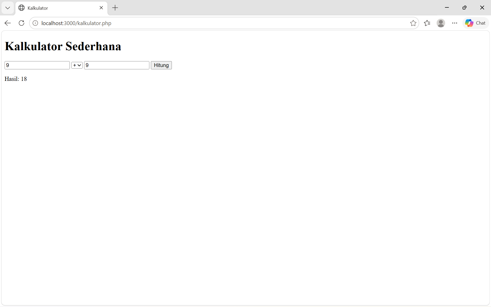
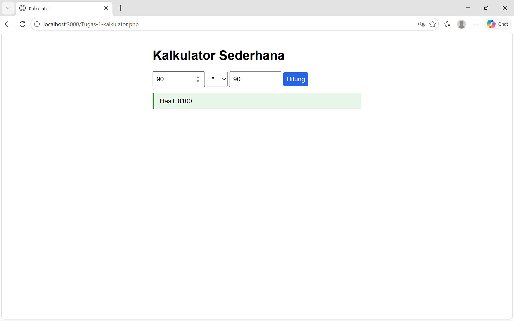
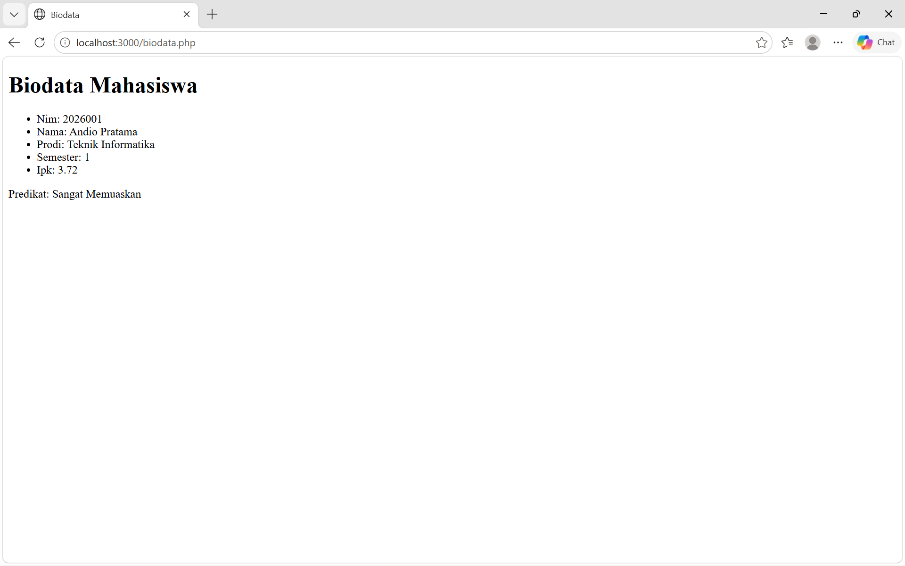
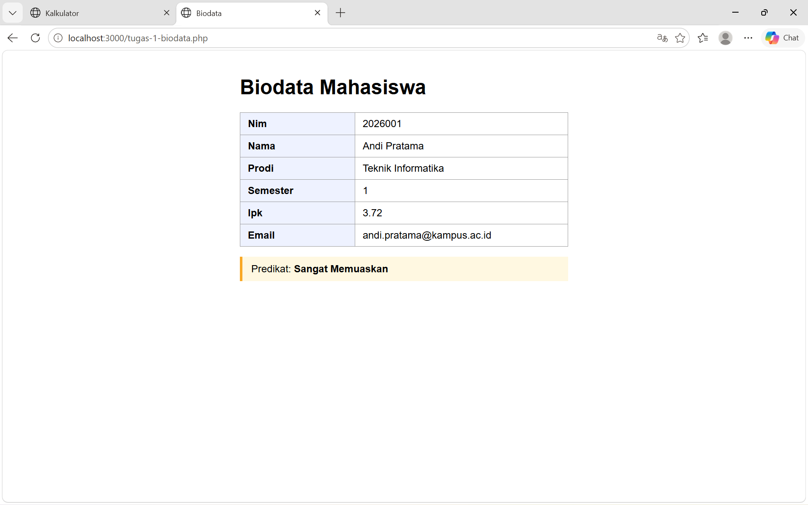

## 📌 Tugas 1 — Pertemuan 1 (Kalkulator & Biodata)
Nama: Alfin Romi Setiawan

NPM: 4524210009

Mata Kuliah: Prak. Pemrograman Berbasis Web

---
### 1. Menjalankan Contoh Pertemuan 1
Seluruh contoh pada Pertemuan 1 (`kalkulator.php` dan `biodata.php`) telah dijalankan melalui `localhost:3000` menggunakan PHP built-in server (`php -S localhost:3000`) dan menghasilkan output tanpa error.

- `kalkulator.php` : input `9 + 9` menghasilkan `Hasil: 18`.
- `biodata.php` : menampilkan data mahasiswa dan `Predikat: Sangat Memuaskan` untuk IPK 3.72.

### 2. Modifikasi yang Dilakukan
File modifikasi: `pertemuan-1/tugas-1-kalkulator.php` (berbasis `kalkulator.php`) dan `pertemuan-1/tugas-1-biodata.php` (berbasis `biodata.php`)

**Kalkulator**

1. **Menambahkan operator baru: modulus `%` dan pangkat `^`** modulus memakai `fmod()` agar tetap akurat untuk angka desimal, pangkat memakai operator `**`. Modulus juga divalidasi agar tidak membagi dengan nol.
2. **Menyimpan nilai input setelah submit** angka dan operator yang dipilih tetap tampil di form setelah tombol **Hitung** ditekan (memakai `value` dan `selected` dari `$_POST`).
3. **Menambahkan styling CSS** tampilan dipercantik dengan tombol biru, hasil dalam kotak hijau, dan pesan error dalam kotak merah.

**Biodata**

1. **Menambahkan field baru `email`** ditambahkan pada array `$mahasiswa` dan otomatis tampil karena memakai `foreach`.
2. **Menambahkan predikat baru `Cum Laude`** untuk IPK ≥ 3.75 pada fungsi `statusKelulusan()`.
3. **Mengubah tampilan menjadi tabel + styling** daftar `<ul>` diganti `<table>`, dan predikat ditampilkan dalam kotak berwarna.

### 3. Penjelasan 5 Bagian Kode Terpenting

| No | Bagian Kode | Penjelasan |
|----|-------------|------------|
| 1 | `$_SERVER['REQUEST_METHOD'] === 'POST'` | Mengecek apakah form sudah dikirim (POST) atau halaman baru dibuka pertama kali (GET), agar kalkulasi hanya berjalan setelah submit. |
| 2 | `(float) ($_POST['a'] ?? 0)` | Mengubah input teks dari form menjadi angka, dengan `??` (null coalescing) untuk mencegah error jika field belum terisi. |
| 3 | `switch ($operator) { case '%': ... case '^': ... }` | Percabangan yang memilih operasi sesuai operator; operator `%` (dengan `fmod()` dan cek `$b == 0`) dan `^` (dengan `**`) ditambahkan di sini sebagai modifikasi. |
| 4 | `htmlspecialchars((string)$hasil)` | Membersihkan output sebelum dicetak ke HTML agar aman dari karakter berbahaya (proteksi dasar XSS). |
| 5 | `foreach ($mahasiswa as $kunci => $nilai)` dan `statusKelulusan()` | Menelusuri array asosiatif untuk mencetak biodata secara otomatis (`ucfirst()` membuat huruf awal key kapital), lalu fungsi menentukan predikat dari IPK. |

### 4. Screenshot Sebelum & Sesudah Modifikasi

**Kalkulator**

Sebelum:

<details>
<summary>Lihat kode <code>kalkulator.php</code></summary>

```php
<?php
// kalkulator.php
$hasil = null;
$pesan = '';

if ($_SERVER['REQUEST_METHOD'] === 'POST') {
    $a = (float) ($_POST['a'] ?? 0);
    $b = (float) ($_POST['b'] ?? 0);
    $operator = $_POST['OPERATOR'] ?? '+';

    switch ($operator) {
        case '+':
            $hasil = $a + $b;
            break;
        case '-':
            $hasil = $a - $b;
            break;
        case '*':
            $hasil = $a * $b;
            break;
        case '/':
            if ($b == 0) {
                $pesan = 'Pembagian dengan nol tidak diperbolehkan.';
            } else {
                $hasil = $a / $b;
            }
            break;
        default:
        $pesan = 'Operator tidak valid.';
    }
}
?>

<!DOCTYPE html>
<html lang="en">
<head>
    <meta charset="UTF-8">
    <title>Kalkulator</title>
</head>
<body>
    <h1>Kalkulator Sederhana</h1>
    <form method="post">
        <input type="number" step="any" name="a" required>
        <select name="operator">
            <option>+</option>
            <option>-</option>
            <option>*</option>
            <option>/</option>
        </select>
        <input type="number" step="any" name="b" required>
        <button type="submit">Hitung</button>
    </form>

    <?php if ($pesan): ?>
        <p><?= htmlspecialchars($pesan) ?></p>
    <?php elseif ($hasil !== null): ?>
        <p>Hasil: <?= htmlspecialchars((string)$hasil) ?></p>
    <?php endif; ?>
</body>
</html>
```

</details>



Sesudah:

<details>
<summary>Lihat kode <code>tugas-1-kalkulator.php</code></summary>

```php
<?php

$hasil = null;
$pesan = '';
$daftarOperator = ['+', '-', '*', '/', '%', '^'];

if ($_SERVER['REQUEST_METHOD'] === 'POST') {
    $a = (float) ($_POST['a'] ?? 0);
    $b = (float) ($_POST['b'] ?? 0);
    $operator = $_POST['operator'] ?? '+';

    switch ($operator) {
        case '+':
            $hasil = $a + $b;
            break;
        case '-':
            $hasil = $a - $b;
            break;
        case '*':
            $hasil = $a * $b;
            break;
        case '/':
            if ($b == 0) {
                $pesan = 'Pembagian dengan nol tidak diperbolehkan.';
            } else {
                $hasil = $a / $b;
            }
            break;
        case '%':
            if ($b == 0) {
                $pesan = 'Modulo dengan nol tidak diperbolehkan.';
            } else {
                $hasil = fmod($a, $b);
            }
            break;
        case '^':
            $hasil = $a ** $b;
            break;
        default:
            $pesan = 'Operator tidak valid.';
    }
}
?>
<!doctype html>
<html lang="id">

<head>
    <meta charset="utf-8">
    <title>Kalkulator</title>
    <style>
        body {
            font-family: Arial, sans-serif;
            max-width: 520px;
            margin: 40px auto;
            padding: 0 16px;
        }

        input,
        select,
        button {
            padding: 8px;
            font-size: 16px;
        }

        input[type=number] {
            width: 110px;
        }

        button {
            background: #2563eb;
            color: #fff;
            border: 0;
            border-radius: 4px;
            cursor: pointer;
        }

        .hasil {
            margin-top: 16px;
            padding: 10px 14px;
            background: #e8f5e9;
            border-left: 4px solid #2e7d32;
        }

        .error {
            margin-top: 16px;
            padding: 10px 14px;
            background: #fdecea;
            border-left: 4px solid #c62828;
        }
    </style>
</head>

<body>
    <h1>Kalkulator Sederhana</h1>
    <form method="post">
        <input type="number" step="any" name="a" required
            value="<?= htmlspecialchars((string) ($_POST['a'] ?? '')) ?>">

        <select name="operator">
            <?php foreach ($daftarOperator as $op): ?>
                <option value="<?= htmlspecialchars($op) ?>"
                    <?= (($_POST['operator'] ?? '+') === $op) ? 'selected' : '' ?>>
                    <?= htmlspecialchars($op) ?>
                </option>
            <?php endforeach; ?>
        </select>

        <input type="number" step="any" name="b" required
            value="<?= htmlspecialchars((string) ($_POST['b'] ?? '')) ?>">

        <button type="submit">Hitung</button>
    </form>

    <?php if ($pesan): ?>
        <p class="error"><?= htmlspecialchars($pesan) ?></p>
    <?php elseif ($hasil !== null): ?>
        <p class="hasil">Hasil: <?= htmlspecialchars((string) $hasil) ?></p>
    <?php endif; ?>
</body>

</html>
```

</details>



**Biodata**

Sebelum:

<details>
<summary>Lihat kode <code>biodata.php</code></summary>

```php
<?php
//biodata.php
function statuskelulusan(float $ipk): string
{
    if ($ipk >=3.50) return 'Sangat Memuaskan';
    if ($ipk >=3.00) return 'Memuaskan';
    return 'perlu peningkatan';
}

$mahasiswa = [
    'nim' => '2026001', 
    'nama' => 'Andio Pratama',
    'prodi' => 'Teknik Informatika',
    'semester' => 1,
    'ipk' => 3.720
];
?>

<!DOCTYPE html>
<html lang="en">
<head>
    <meta charset="UTF-8">
    <title>Biodata</title>
</head>
<body>
    <h1>Biodata Mahasiswa</h1>
    <ul>
        <?php foreach ($mahasiswa as $kunci => $nilai): ?>
        <li><?= ucfirst($kunci) ?>: <?= htmlspecialchars((string)$nilai) ?>
        </li>
        <?php endforeach; ?>
    </ul>
    <p>Predikat: <?= statuskelulusan($mahasiswa['ipk']) ?></p>
</body>
</html>
```

</details>



Sesudah:

<details>
<summary>Lihat kode <code>tugas-1-biodata.php</code></summary>

```php
<?php

function statusKelulusan(float $ipk): string
{
    if ($ipk >= 3.75) return 'Cum Laude';
    if ($ipk >= 3.50) return 'Sangat Memuaskan';
    if ($ipk >= 3.00) return 'Memuaskan';
    return 'Perlu Peningkatan';
}

$mahasiswa = [
    'nim'      => '2026001',
    'nama'     => 'Andi Pratama',
    'prodi'    => 'Teknik Informatika',
    'semester' => 1,
    'ipk'      => 3.72,
    'email'    => 'andi.pratama@kampus.ac.id',
];
?>
<!doctype html>
<html lang="id">

<head>
    <meta charset="utf-8">
    <title>Biodata</title>
    <style>
        body {
            font-family: Arial, sans-serif;
            max-width: 520px;
            margin: 40px auto;
            padding: 0 16px;
        }

        table {
            border-collapse: collapse;
            width: 100%;
        }

        td {
            border: 1px solid #999;
            padding: 8px 12px;
        }

        td:first-child {
            background: #eef2ff;
            font-weight: bold;
            width: 35%;
        }

        .predikat {
            margin-top: 16px;
            padding: 10px 14px;
            background: #fff8e1;
            border-left: 4px solid #f9a825;
        }
    </style>
</head>

<body>
    <h1>Biodata Mahasiswa</h1>
    <table>
        <?php foreach ($mahasiswa as $kunci => $nilai): ?>
            <tr>
                <td><?= ucfirst($kunci) ?></td>
                <td><?= htmlspecialchars((string) $nilai) ?></td>
            </tr>
        <?php endforeach; ?>
    </table>
    <p class="predikat">Predikat: <strong><?= statusKelulusan($mahasiswa['ipk']) ?></strong></p>
</body>

</html>
```

</details>



### 5. Error yang Pernah Muncul

- **Error:** Operator yang dipilih di kalkulator selalu dihitung sebagai penjumlahan (`+`), misalnya `90 * 90` menghasilkan `180`.
- **Penyebab:** Pada kode awal, operator dibaca dengan `$_POST['OPERATOR']` (huruf kapital), sedangkan nama field di form adalah `name="operator"` (huruf kecil). Key array PHP bersifat *case-sensitive*, sehingga nilainya `null` dan `??` memakai default `'+'`.
- **Perbaikan:** Mengubah menjadi `$_POST['operator']` agar sama persis dengan atribut `name` pada form.