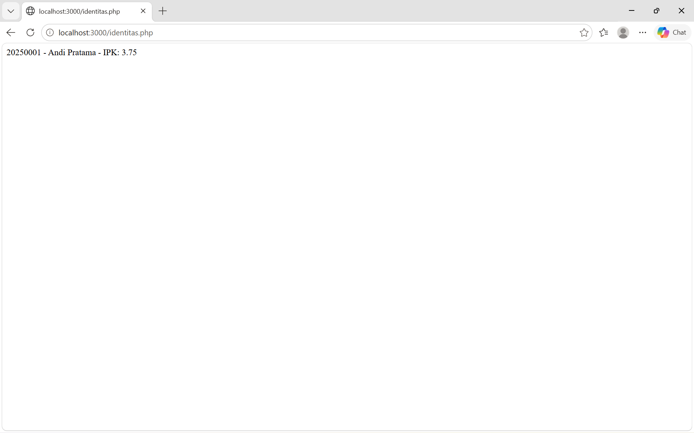
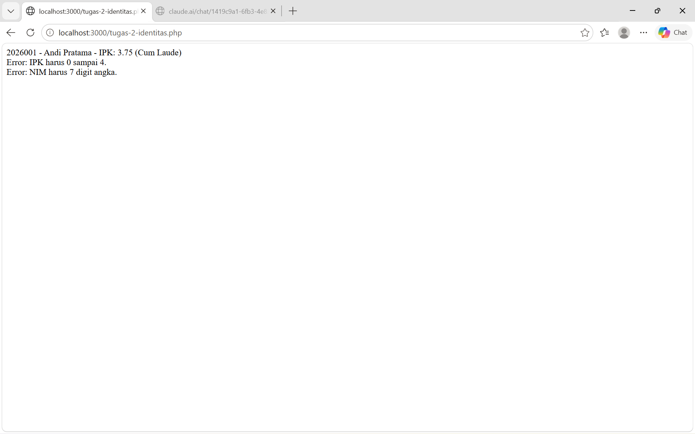
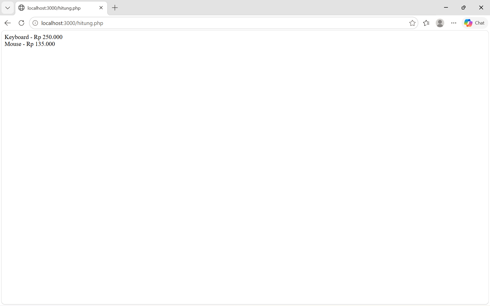
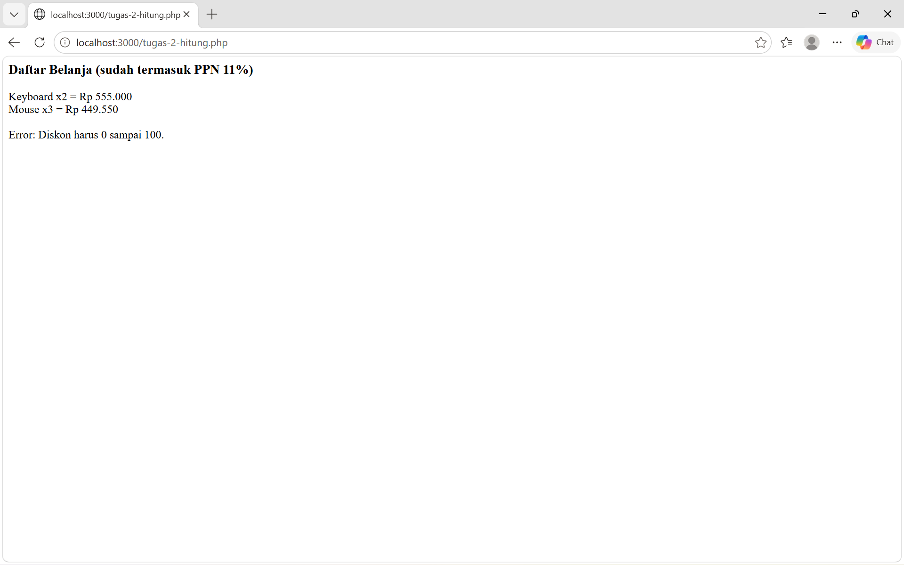

## 📌 Tugas 2 — Pertemuan 2 (Identitas & Hitung)
Nama: Alfin Romi Setiawan

NPM: 4524210009

Mata Kuliah: Prak. Pemrograman Berbasis Web

---
### 1. Menjalankan Contoh Pertemuan 2
Seluruh contoh pada Pertemuan 2 (`identitas.php` dan `hitung.php`) telah dijalankan melalui `localhost:3000` menggunakan PHP built-in server (`php -S localhost:3000`) dan menghasilkan output tanpa error.

- `identitas.php` : menampilkan `20250001 - Andi Pratama - IPK: 3.75`.
- `hitung.php` : menampilkan `Keyboard - Rp 250.000` dan `Mouse - Rp 135.000` (harga Rp 150.000 dengan diskon 10%).

### 2. Modifikasi yang Dilakukan
File modifikasi: `pertemuan-2/tugas-2-identitas.php` (berbasis `identitas.php`) dan `pertemuan-2/tugas-2-hitung.php` (berbasis `hitung.php`)

1. **Menambahkan validasi NIM 7 digit angka (identitas)** method `setNim()` memakai `preg_match('/^\d{7}$/')` dan melempar `InvalidArgumentException` jika NIM tidak sesuai.
2. **Menambahkan predikat kelulusan (identitas)** method `predikat()` menentukan *Cum Laude* (IPK ≥ 3.51), *Sangat Memuaskan* (≥ 3.00), atau *Memuaskan*, lalu ditampilkan di `ringkasan()`. Pembuatan objek juga dibungkus `try-catch` agar error tampil sebagai pesan.
3. **Menambahkan PPN 11% dan jumlah barang (hitung)** konstanta `Produk::PPN` dan properti `jumlah` ditambahkan, sehingga harga akhir = harga satuan × jumlah × 1,11.
4. **Menambahkan validasi diskon 0–100 (hitung)** `ProdukDiskon` melempar exception jika diskon di luar rentang (diuji dengan diskon 150).

### 3. Penjelasan 5 Bagian Kode Terpenting

| No | Bagian Kode | Penjelasan |
|----|-------------|------------|
| 1 | `interface BisaDihitung` dan `implements` | Interface adalah kontrak: class yang meng-*implements*-nya wajib memiliki method `hargaAkhir()`, sehingga semua objek bisa diperlakukan sama. |
| 2 | `__construct(protected string $nama, protected float $harga)` | Constructor promotion: parameter langsung menjadi properti class. `protected` membuat properti hanya bisa diakses class itu dan turunannya (encapsulation). |
| 3 | `class ProdukDiskon extends Produk` dan `parent::__construct()` | Inheritance: `ProdukDiskon` mewarisi `Produk`, memanggil constructor induk, dan meng-*override* `hargaAkhir()` agar memperhitungkan diskon. |
| 4 | `throw new InvalidArgumentException(...)` | Validasi pada setter menjaga data objek tetap valid; jika tidak valid, exception dilempar dan ditangkap `try-catch` agar program tidak berhenti dengan Fatal error. |
| 5 | `foreach ($daftar as $produk)` dan `number_format()` | Polimorfisme: tiap objek menjalankan versi `hargaAkhir()` miliknya sendiri. `number_format()` memformat angka ke format rupiah. |

### 4. Screenshot Sebelum & Sesudah Modifikasi

**Identitas**

Sebelum:

<details>
<summary>Lihat kode <code>identitas.php</code></summary>

```php
<?php
interface Identitas
{
    public function ringkasan(): string;
}

class Mahasiswa implements Identitas
{
    private string $nim;
    private string $nama;
    protected float $ipk;

    public function __construct(string $nim, string $nama, float $ipk)
    {
        $this->nim = $nim;
        $this->nama = $nama;
        $this->setIpk($ipk);
    }

    public function setIpk(float $ipk): void
    {
        if ($ipk < 0 || $ipk > 4) {
            throw new InvalidArgumentException('IPK harus 0 sampai 4.');
        }
        $this->ipk = $ipk;
    }

    public function getIpk(): float
    {
        return $this->ipk;
    }

    public function ringkasan(): string
    {
        return $this->nim . ' - ' . $this->nama . ' - IPK: ' . $this->ipk;
    }
}

$mhs = new Mahasiswa('20250001', 'Andi Pratama', 3.75);
echo $mhs->ringkasan();
```

</details>



Sesudah:

<details>
<summary>Lihat kode <code>tugas-2-identitas.php</code></summary>

```php
<?php
// tugas-2-identitas.php (versi modifikasi)
interface Identitas
{
    public function ringkasan(): string;
}

class Mahasiswa implements Identitas
{
    private string $nim;
    private string $nama;
    protected float $ipk;

    public function __construct(string $nim, string $nama, float $ipk)
    {
        $this->setNim($nim);
        $this->nama = $nama;
        $this->setIpk($ipk);
    }

    // Modifikasi 1: validasi NIM harus 7 digit angka
    public function setNim(string $nim): void
    {
        if (!preg_match('/^\d{7}$/', $nim)) {
            throw new InvalidArgumentException('NIM harus 7 digit angka.');
        }
        $this->nim = $nim;
    }

    public function setIpk(float $ipk): void
    {
        if ($ipk < 0 || $ipk > 4) {
            throw new InvalidArgumentException('IPK harus 0 sampai 4.');
        }
        $this->ipk = $ipk;
    }

    public function getIpk(): float
    {
        return $this->ipk;
    }

    // Modifikasi 2: predikat kelulusan berdasarkan IPK
    public function predikat(): string
    {
        if ($this->ipk >= 3.51) return 'Cum Laude';
        if ($this->ipk >= 3.00) return 'Sangat Memuaskan';
        return 'Memuaskan';
    }

    public function ringkasan(): string
    {
        return $this->nim . ' - ' . $this->nama . ' - IPK: ' . $this->ipk . ' (' . $this->predikat() . ')';
    }
}

// Modifikasi 3: try-catch agar exception tampil sebagai pesan, bukan Fatal error
$data = [
    ['2026001', 'Andi Pratama', 3.75],   // valid
    ['2026002', 'Budi Santoso', 4.5],    // IPK tidak valid
    ['12345',   'Citra Lestari', 3.2],   // NIM tidak valid
];

foreach ($data as [$nim, $nama, $ipk]) {
    try {
        $mhs = new Mahasiswa($nim, $nama, $ipk);
        echo htmlspecialchars($mhs->ringkasan()) . "<br>";
    } catch (InvalidArgumentException $e) {
        echo 'Error: ' . htmlspecialchars($e->getMessage()) . "<br>";
    }
}
```

</details>



**Hitung**

Sebelum:

<details>
<summary>Lihat kode <code>hitung.php</code></summary>

```php
<?php
interface BisaDihitung
{
    public function hargaAkhir(): float;
}

class Produk implements BisaDihitung
{
    public function __construct(
        protected string $nama,
        protected float $harga
    ) {}

    public function hargaAkhir(): float
    {
        return $this->harga;
    }

    public function getNama(): string
    {
        return $this->nama;
    }
}

class ProdukDiskon extends Produk
{
    public function __construct(string $nama, float $harga, private float $diskon)
    {
        parent::__construct($nama, $harga);
    }

    public function hargaAkhir(): float
    {
        return $this->harga * (1 - $this->diskon / 100);
    }
}

$daftar = [
    new Produk('Keyboard', 250000),
    new ProdukDiskon('Mouse', 150000, 10)
];

foreach ($daftar as $produk) {
    echo $produk->getNama() . ' - Rp ' . number_format($produk->hargaAkhir(), 0, ',', '.') . "<br>";
}
```

</details>



Sesudah:

<details>
<summary>Lihat kode <code>tugas-2-hitung.php</code></summary>

```php
<?php
// tugas-2-hitung.php (versi modifikasi)
interface BisaDihitung
{
    public function hargaAkhir(): float;
}

class Produk implements BisaDihitung
{
    public const PPN = 11; // Modifikasi 1: PPN 11%

    public function __construct(
        protected string $nama,
        protected float $harga,
        protected int $jumlah = 1 // Modifikasi 2: field jumlah (qty)
    ) {}

    protected function hargaSatuan(): float
    {
        return $this->harga;
    }

    public function hargaAkhir(): float
    {
        return $this->hargaSatuan() * $this->jumlah * (1 + self::PPN / 100);
    }

    public function getNama(): string
    {
        return $this->nama;
    }

    public function getJumlah(): int
    {
        return $this->jumlah;
    }
}

class ProdukDiskon extends Produk
{
    public function __construct(string $nama, float $harga, private float $diskon, int $jumlah = 1)
    {
        // Modifikasi 3: validasi diskon 0-100
        if ($diskon < 0 || $diskon > 100) {
            throw new InvalidArgumentException('Diskon harus 0 sampai 100.');
        }
        parent::__construct($nama, $harga, $jumlah);
    }

    protected function hargaSatuan(): float
    {
        return $this->harga * (1 - $this->diskon / 100);
    }
}

echo '<h3>Daftar Belanja (sudah termasuk PPN ' . Produk::PPN . '%)</h3>';

try {
    $daftar = [
        new Produk('Keyboard', 250000, 2),
        new ProdukDiskon('Mouse', 150000, 10, 3),
    ];

    foreach ($daftar as $produk) {
        echo $produk->getNama() . ' x' . $produk->getJumlah()
            . ' = Rp ' . number_format($produk->hargaAkhir(), 0, ',', '.') . '<br>';
    }

    // Uji validasi: diskon 150% memicu exception
    $salah = new ProdukDiskon('Headset', 300000, 150);
} catch (InvalidArgumentException $e) {
    echo '<br>Error: ' . htmlspecialchars($e->getMessage());
}
```

</details>



### 5. Error yang Pernah Muncul

- **Error:** `Fatal error: Uncaught InvalidArgumentException: IPK harus 0 sampai 4.` saat diuji dengan IPK `4.5`.
- **Penyebab:** `setIpk()` melempar `InvalidArgumentException`, tetapi pembuatan objek `new Mahasiswa(...)` belum dibungkus `try-catch`, sehingga exception tidak tertangkap dan program berhenti.
- **Perbaikan:** Membungkus pembuatan objek dengan `try { ... } catch (InvalidArgumentException $e) { echo 'Error: ' . $e->getMessage(); }` sehingga muncul pesan `Error: IPK harus 0 sampai 4.`