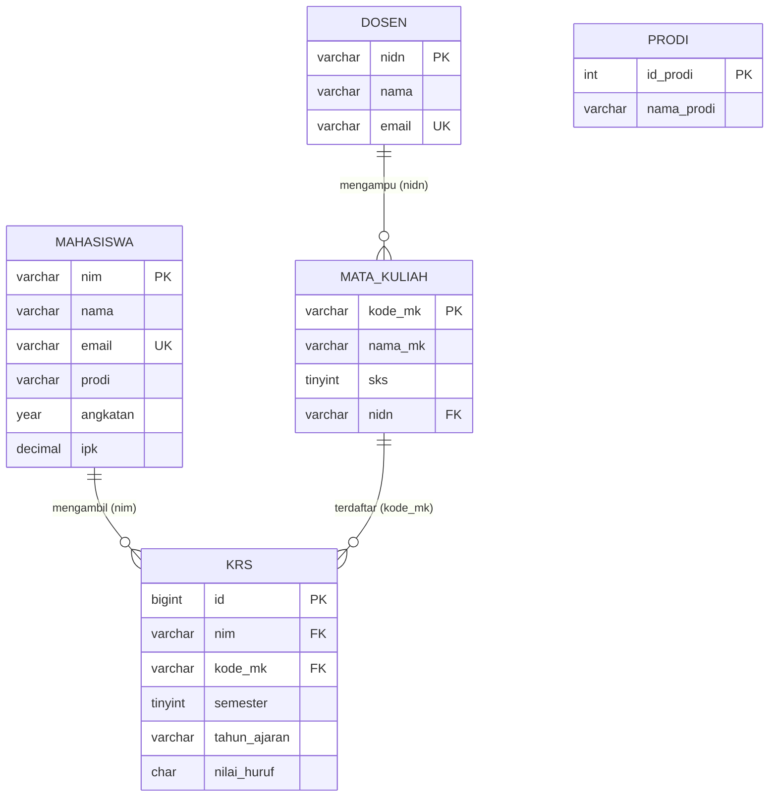
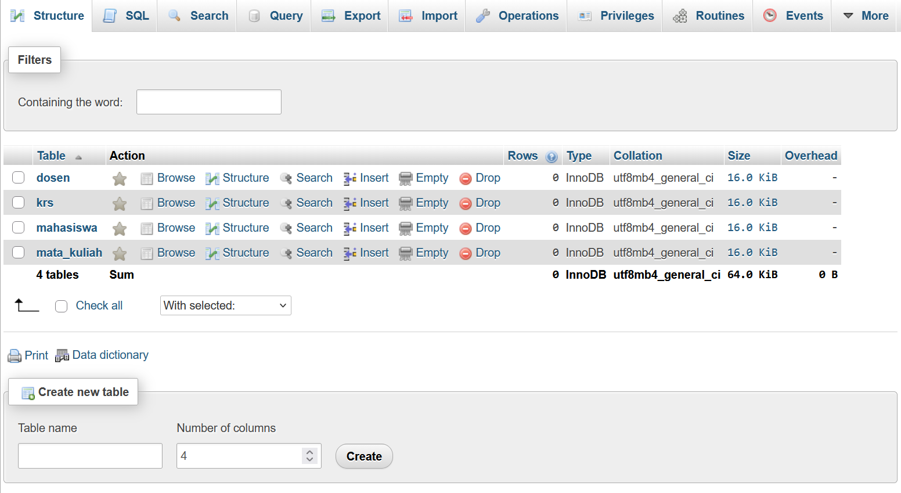
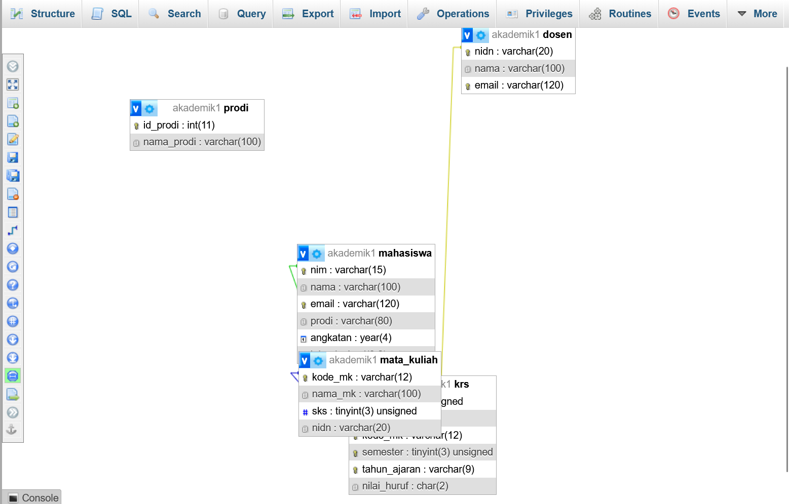

# Laporan Praktikum Pertemuan 4 — Relasi Multi-Tabel & Integritas Referensial (`akademik1`)

> **Mata Kuliah:** Pemrograman Berbasis Web  
> **Topik:** Desain Skema Relasional Lanjutan (Mahasiswa, Dosen, Mata Kuliah, KRS, Prodi) & Constraint Cascade di MariaDB/MySQL  
> **File SQL:** [`akademik1(2).sql`](./akademik1(2).sql)  
> **Nama Mahasiswa:** `[Isi Nama Anda]`  
> **NPM:** `[Isi NPM Anda]`  
> **Kelas:** `[Isi Kelas Anda]`

---

## 1. Eksekusi Seluruh Contoh Pertemuan 4 (Tanpa Error Kritis)

Seluruh definisi tabel, indeks, *composite unique key*, dan *foreign key constraint* pada database `akademik1` telah dijalankan menggunakan **XAMPP (MariaDB 10.4.32 & phpMyAdmin 5.2.1)** dan diekspor ke berkas [`akademik1(2).sql`](./akademik1(2).sql) tanpa error kritis.

### Cara Menjalankan di XAMPP / phpMyAdmin

1. Jalankan modul **Apache** dan **MySQL** melalui **XAMPP Control Panel**.
2. Buka browser dan akses `http://localhost/phpmyadmin`.
3. Buat database baru bernama `akademik1` dengan collation `utf8mb4_general_ci`.
4. Pilih tab **Import**, pilih berkas `akademik1(2).sql`, lalu klik **Go / Import**.

### Ringkasan Struktur 5 Tabel pada `akademik1`

| Tabel | Primary Key | Kolom Penting | Indeks & Foreign Key |
|---|---|---|---|
| `dosen` | `nidn` (`varchar(20)`) | `nama`, `email` | `UNIQUE (email)` |
| `mahasiswa` | `nim` (`varchar(15)`) | `nama`, `email`, `prodi`, `angkatan`, `ipk` (`DEFAULT 0.00`) | `UNIQUE (email)` |
| `mata_kuliah` | `kode_mk` (`varchar(12)`) | `nama_mk`, `sks` (`tinyint UNSIGNED`), `nidn` | `fk_mk_dosen -> dosen(nidn)` (`ON DELETE SET NULL ON UPDATE CASCADE`) |
| `krs` | `id` (`bigint UNSIGNED`, `AUTO_INCREMENT`) | `nim`, `kode_mk`, `semester`, `tahun_ajaran`, `nilai_huruf` | `UNIQUE uq_krs (nim, kode_mk, semester, tahun_ajaran)`, `fk_krs_mahasiswa`, `fk_krs_mk` |
| `prodi` | `id_prodi` (`int(11)`, `AUTO_INCREMENT`) | `nama_prodi` | — |

### Diagram Relasi (ERD)



---

## 2. Modifikasi Bermakna pada Program / Basis Data

Berikut adalah **modifikasi bermakna** pada rancangan database `akademik1` serta query/validasi pengembangannya:

### Modifikasi 1 — Penambahan Tabel `prodi` dan Perubahan Primary Key Alami (*Natural Key*) pada `mahasiswa`
- **Tujuan:** Menggunakan `nim` secara langsung sebagai `PRIMARY KEY` pada tabel `mahasiswa` (menggantikan `id` integer pada pertemuan sebelumnya) agar relasi KRS langsung merujuk ke `nim`, sekaligus menambahkan tabel `prodi` sebagai master data program studi.
- **Implementasi pada `akademik1(2).sql`:**
  ```sql
  CREATE TABLE `mahasiswa` (
    `nim` varchar(15) NOT NULL,
    `nama` varchar(100) NOT NULL,
    `email` varchar(120) NOT NULL,
    `prodi` varchar(80) NOT NULL,
    `angkatan` year(4) NOT NULL,
    `ipk` decimal(3,2) DEFAULT 0.00
  ) ENGINE=InnoDB DEFAULT CHARSET=utf8mb4 COLLATE=utf8mb4_general_ci;

  CREATE TABLE `prodi` (
    `id_prodi` int(11) NOT NULL,
    `nama_prodi` varchar(100) DEFAULT NULL
  ) ENGINE=InnoDB DEFAULT CHARSET=utf8mb4 COLLATE=utf8mb4_general_ci;
  ```

### Modifikasi 2 — Implementasi Composite Unique Key (`uq_krs`) dan Kebijakan Cascade Berbeda pada Relasi KRS & Mata Kuliah
- **Tujuan:** Mencegah mahasiswa mengambil mata kuliah yang sama dua kali pada semester dan tahun ajaran yang sama, serta membedakan perilaku penghapusan data induk:
  - Jika data `mahasiswa` dihapus, riwayat `krs`-nya ikut terhapus (`ON DELETE CASCADE`).
  - Jika data `dosen` dihapus, `mata_kuliah` tidak ikut terhapus melainkan `nidn`-nya di-set `NULL` (`ON DELETE SET NULL`).
- **Contoh Query Uji & Validasi Lanjutan (Data Sample + Multi-Table `JOIN`):**
  ```sql
  -- Contoh pengisian data uji berurutan (induk -> anak)
  INSERT INTO dosen (nidn, nama, email) VALUES
  ('0001028501', 'Dr. Budi Santoso', 'budi@kampus.ac.id');

  INSERT INTO mata_kuliah (kode_mk, nama_mk, sks, nidn) VALUES
  ('IF201', 'Pemrograman Berbasis Web', 3, '0001028501');

  INSERT INTO mahasiswa (nim, nama, email, prodi, angkatan, ipk) VALUES
  ('2026001', 'Andi Pratama', 'andi@kampus.ac.id', 'Teknik Informatika', 2026, 3.75);

  INSERT INTO krs (nim, kode_mk, semester, tahun_ajaran, nilai_huruf) VALUES
  ('2026001', 'IF201', 3, '2026/2027', 'A');

  -- Query gabungan 4 tabel untuk menampilkan Kartu Rencana Studi lengkap
  SELECT k.id, m.nim, m.nama AS nama_mahasiswa, mk.kode_mk, mk.nama_mk,
         mk.sks, d.nama AS dosen_pengampu, k.semester, k.tahun_ajaran, k.nilai_huruf
  FROM krs k
  INNER JOIN mahasiswa m ON k.nim = m.nim
  INNER JOIN mata_kuliah mk ON k.kode_mk = mk.kode_mk
  LEFT JOIN dosen d ON mk.nidn = d.nidn;
  ```

---

## 3. Penjelasan Lima Bagian Kode Paling Penting

1. **Composite Unique Key `uq_krs` pada Tabel `krs`**
   ```sql
   ALTER TABLE `krs`
     ADD PRIMARY KEY (`id`),
     ADD UNIQUE KEY `uq_krs` (`nim`,`kode_mk`,`semester`,`tahun_ajaran`),
     ADD KEY `fk_krs_mk` (`kode_mk`);
   ```
   **Penjelasan:** Kombinasi 4 kolom (`nim`, `kode_mk`, `semester`, `tahun_ajaran`) dijadikan kunci unik gabungan. Seorang mahasiswa tetap boleh mengulang mata kuliah yang sama di semester/tahun ajaran berbeda, tetapi tidak bisa mendaftarkan mata kuliah yang sama dua kali pada periode yang sama.

2. **Constraint `ON DELETE CASCADE ON UPDATE CASCADE` pada `fk_krs_mahasiswa`**
   ```sql
   ALTER TABLE `krs`
     ADD CONSTRAINT `fk_krs_mahasiswa` FOREIGN KEY (`nim`) REFERENCES `mahasiswa` (`nim`)
     ON DELETE CASCADE ON UPDATE CASCADE;
   ```
   **Penjelasan:** Jika `nim` mahasiswa diubah, seluruh baris terkait di tabel `krs` otomatis ikut diperbarui (`ON UPDATE CASCADE`). Jika data mahasiswa dihapus, seluruh entri KRS milik mahasiswa tersebut juga otomatis terhapus (`ON DELETE CASCADE`) sehingga tidak meninggalkan data yatim (*orphan records*).

3. **Constraint `ON DELETE SET NULL ON UPDATE CASCADE` pada `fk_mk_dosen`**
   ```sql
   ALTER TABLE `mata_kuliah`
     ADD CONSTRAINT `fk_mk_dosen` FOREIGN KEY (`nidn`) REFERENCES `dosen` (`nidn`)
     ON DELETE SET NULL ON UPDATE CASCADE;
   ```
   **Penjelasan:** Ketika data dosen dihapus, mata kuliah yang pernah diampunya tetap dipertahankan di kurikulum dan kolom `nidn` otomatis berubah menjadi `NULL` agar bisa dialihkan ke dosen pengganti.

4. **Proteksi Penghapusan Mata Kuliah pada `fk_krs_mk`**
   ```sql
   ALTER TABLE `krs`
     ADD CONSTRAINT `fk_krs_mk` FOREIGN KEY (`kode_mk`) REFERENCES `mata_kuliah` (`kode_mk`)
     ON UPDATE CASCADE;
   ```
   **Penjelasan:** Karena tidak mencantumkan `ON DELETE CASCADE` (menggunakan perilaku default `RESTRICT`), mata kuliah yang sudah diambil mahasiswa di tabel `krs` tidak dapat dihapus sembarangan sebelum data KRS terkait diselesaikan.

5. **Pemilihan Tipe Data Numerik Unsigned & Nilai Default pada `krs` dan `mahasiswa`**
   ```sql
   `id` bigint(20) UNSIGNED NOT NULL,
   `semester` tinyint(3) UNSIGNED NOT NULL,
   `sks` tinyint(3) UNSIGNED NOT NULL,
   `ipk` decimal(3,2) DEFAULT 0.00
   ```
   **Penjelasan:** `UNSIGNED` mencegah angka negatif untuk ID, `semester`, dan `sks`, sekaligus menghemat kapasitas penyimpanan dengan `tinyint` untuk nilai kecil (`sks` dan `semester`). Kolom `ipk` diberi `DEFAULT 0.00` agar mahasiswa baru otomatis memiliki nilai awal yang valid.

---

## 4. Screenshot Sebelum dan Sesudah Modifikasi

> **Catatan:** Letakkan file screenshot hasil eksekusi dari phpMyAdmin/Designer/SQL tab Anda ke dalam folder `screenshots/` di direktori `pert 4/` sesuai nama berkas di bawah ini sebelum *push* ke GitHub.

### Sebelum Modifikasi (Skema Awal Sebelum Relasi Lengkap / Tabel `prodi`)


*Keterangan: Tampilan awal database `akademik1` sebelum penambahan tabel/relasi lengkap dan uji query.*

### Sesudah Modifikasi (5 Tabel Relasional `akademik1` & Designer phpMyAdmin)


*Keterangan: Tampilan struktur 5 tabel (`dosen`, `krs`, `mahasiswa`, `mata_kuliah`, `prodi`), diagram relasi Designer phpMyAdmin, dan hasil eksekusi query.*

---

## 5. Error yang Pernah Muncul, Penyebab, dan Langkah Perbaikannya

- **Error yang Muncul:**
  ```text
  #1452 - Cannot add or update a child row: a foreign key constraint fails
  (`akademik1`.`krs`, CONSTRAINT `fk_krs_mk` FOREIGN KEY (`kode_mk`) REFERENCES `mata_kuliah` (`kode_mk`) ON UPDATE CASCADE)
  ```
- **Penyebab:**
  Data pada tabel anak (`krs`) dimasukkan sebelum data referensi pada tabel induk (`mahasiswa` atau `mata_kuliah`) tersedia, atau `kode_mk` / `nim` yang diinput pada `krs` tidak terdaftar di tabel induknya. Hal serupa juga terjadi pada `mata_kuliah` jika `nidn` tidak ada di tabel `dosen` (kecuali diisi `NULL`).
- **Langkah Perbaikan:**
  1. Pastikan urutan pengisian data mengikuti hierarki relasi: isi terlebih dahulu `dosen` dan `mahasiswa`, lalu `mata_kuliah`, dan terakhir tabel transaksi `krs`.
  2. Verifikasi keberadaan `nim` di tabel `mahasiswa` dan `kode_mk` di tabel `mata_kuliah` sebelum melakukan `INSERT` ke `krs`.
  3. Untuk skrip import/dump SQL yang memasang constraint di bagian akhir atau menyertakan relasi silang, pastikan seluruh tabel induk dan anak berada dalam satu transaksi yang konsisten.
