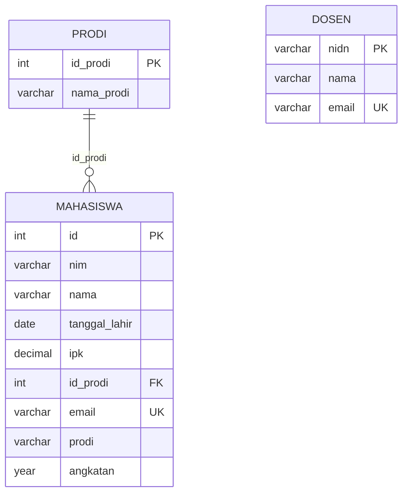
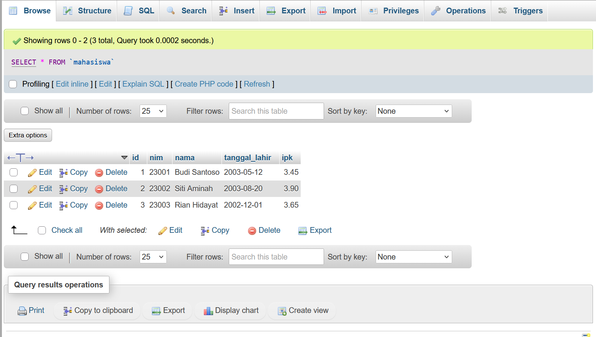
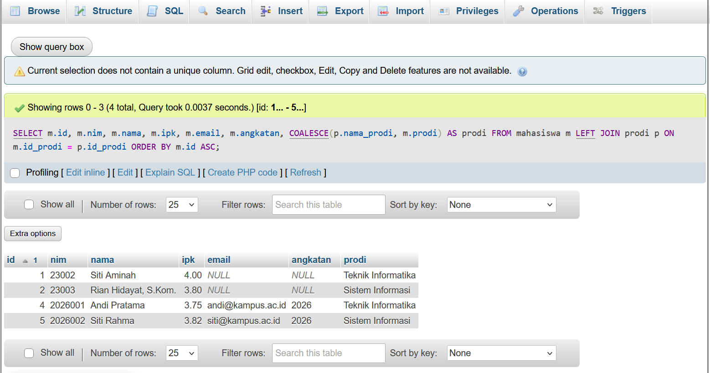

# Laporan Praktikum Pertemuan 3 — Pengenalan Database & SQL Dasar (`akademik`)

> **Mata Kuliah:** Pemrograman Berbasis Web  
> **Topik:** Perancangan Basis Data Relasional, DDL, DML, dan Foreign Key di MariaDB/MySQL (XAMPP)  
> **File SQL:** [`akademik.sql`](./akademik.sql)  
> **Nama Mahasiswa:** `[Alfin Romi Setiawan]`  
> **NPM:** `[4524210009]`  
---

## 1. Eksekusi Seluruh Contoh Pertemuan 3 (Tanpa Error Kritis)

Seluruh skrip DDL (*Data Definition Language*) dan DML (*Data Manipulation Language*) pada database `akademik` telah dijalankan melalui **XAMPP (MariaDB 10.4.32 & phpMyAdmin 5.2.1)** dan diekspor ke dalam berkas [`akademik.sql`](./akademik.sql) tanpa error kritis.

### Cara Menjalankan di XAMPP / phpMyAdmin

1. Jalankan modul **Apache** dan **MySQL** melalui **XAMPP Control Panel**.
2. Buka browser dan akses `http://localhost/phpmyadmin`.
3. Buat database baru bernama `akademik` dengan collation `utf8mb4_general_ci`.
4. Pilih tab **Import**, pilih berkas `akademik.sql`, lalu klik **Go / Import**.

### Ringkasan Tabel & Data yang Terbentuk

| Tabel | Jumlah Kolom | Primary Key | Unique / Foreign Key | Jumlah Baris |
|---|---|---|---|---|
| `dosen` | 3 (`nidn`, `nama`, `email`) | `nidn` | `UNIQUE (email)` | 0 |
| `prodi` | 2 (`id_prodi`, `nama_prodi`) | `id_prodi` (`AUTO_INCREMENT`) | — | 3 |
| `mahasiswa` | 9 (`id`, `nim`, `nama`, `tanggal_lahir`, `ipk`, `id_prodi`, `email`, `prodi`, `angkatan`) | `id` (`AUTO_INCREMENT`) | `UNIQUE (email)`, `FK fk_mhs1_prodi -> prodi(id_prodi)` | 4 |

### Diagram Relasi (ERD)



### Cuplikan Isi Data `prodi` & `mahasiswa`

- **Tabel `prodi`:**
  - `1` — Teknik Informatika
  - `2` — Sistem Informasi
  - `3` — Teknik Elektro
- **Tabel `mahasiswa`:**
  - `id=1`: `23002` | Siti Aminah | `2003-08-20` | IPK `4.00` | `id_prodi=1`
  - `id=2`: `23003` | Rian Hidayat, S.Kom. | `2002-12-01` | IPK `3.80` | `id_prodi=2`
  - `id=4`: `2026001` | Andi Pratama | IPK `3.75` | `andi@kampus.ac.id` | Teknik Informatika | `2026`
  - `id=5`: `2026002` | Siti Rahma | IPK `3.82` | `siti@kampus.ac.id` | Sistem Informasi | `2026`

---

## 2. Modifikasi Bermakna pada Program / Basis Data

Berikut adalah **modifikasi bermakna** yang diterapkan pada database `akademik` dibandingkan skema awal dasar satu tabel:

### Modifikasi 1 — Penambahan Tabel Referensi `prodi` dan Relasi Foreign Key (`fk_mhs1_prodi`) + Tabel `dosen`
- **Tujuan:** Menghindari duplikasi penulisan nama program studi secara manual dan menjaga integritas referensial antara data mahasiswa dan program studi, sekaligus menyiapkan entitas `dosen`.
- **Implementasi pada `akademik.sql`:**
  ```sql
  CREATE TABLE `prodi` (
    `id_prodi` int(11) NOT NULL,
    `nama_prodi` varchar(100) NOT NULL
  ) ENGINE=InnoDB DEFAULT CHARSET=utf8mb4 COLLATE=utf8mb4_general_ci;

  ALTER TABLE `mahasiswa`
    ADD CONSTRAINT `fk_mhs1_prodi` FOREIGN KEY (`id_prodi`) REFERENCES `prodi` (`id_prodi`);
  ```
- **Dampak:** Nilai `id_prodi` pada tabel `mahasiswa` hanya dapat diisi dengan ID yang valid dari tabel `prodi` (`1`, `2`, atau `3`).

### Modifikasi 2 — Penambahan Field Identitas Akademik (`email`, `prodi`, `angkatan`) dengan Constraint `UNIQUE`
- **Tujuan:** Memperkaya atribut mahasiswa agar mendukung data kontak (`email`) yang unik serta informasi program studi dan tahun masuk (`angkatan`), disertai pembaruan data (`UPDATE`) dan penghapusan data uji (`DELETE`, terlihat dari celah `id=3`).
- **Implementasi pada `akademik.sql`:**
  ```sql
  -- Kolom tambahan pada tabel mahasiswa:
  -- `email` varchar(120) DEFAULT NULL,
  -- `prodi` varchar(80) DEFAULT NULL,
  -- `angkatan` year(4) DEFAULT NULL

  ALTER TABLE `mahasiswa`
    ADD UNIQUE KEY `email` (`email`);
  ```
- **Contoh Query `JOIN` untuk Menampilkan Mahasiswa beserta Nama Prodi:**
  ```sql
  SELECT m.nim, m.nama, m.ipk, p.nama_prodi
  FROM mahasiswa m
  LEFT JOIN prodi p ON m.id_prodi = p.id_prodi
  ORDER BY m.id ASC;
  ```

---

## 3. Penjelasan Lima Bagian Kode Paling Penting

1. **Definisi Tabel `mahasiswa` dengan Tipe Data Presisi dan Engine `InnoDB`**
   ```sql
   CREATE TABLE `mahasiswa` (
     `id` int(11) NOT NULL,
     `nim` varchar(15) DEFAULT NULL,
     `nama` varchar(100) DEFAULT NULL,
     `tanggal_lahir` date DEFAULT NULL,
     `ipk` decimal(3,2) DEFAULT NULL,
     `id_prodi` int(11) DEFAULT NULL,
     `email` varchar(120) DEFAULT NULL,
     `prodi` varchar(80) DEFAULT NULL,
     `angkatan` year(4) DEFAULT NULL
   ) ENGINE=InnoDB DEFAULT CHARSET=utf8mb4 COLLATE=utf8mb4_general_ci;
   ```
   **Penjelasan:** Menggunakan `decimal(3,2)` agar nilai IPK tersimpan akurat hingga 2 angka di belakang koma (misal `4.00`, `3.75`) tanpa galat pembulatan *floating-point*, serta `ENGINE=InnoDB` agar tabel mendukung transaksi dan *Foreign Key*.

2. **Penerapan `PRIMARY KEY` dan `UNIQUE KEY` pada Tabel `mahasiswa` dan `dosen`**
   ```sql
   ALTER TABLE `dosen`
     ADD PRIMARY KEY (`nidn`),
     ADD UNIQUE KEY `email` (`email`);

   ALTER TABLE `mahasiswa`
     ADD PRIMARY KEY (`id`),
     ADD UNIQUE KEY `email` (`email`),
     ADD KEY `fk_mhs1_prodi` (`id_prodi`);
   ```
   **Penjelasan:** `PRIMARY KEY` menjamin identitas unik setiap baris, sedangkan `UNIQUE KEY email` mencegah dua mahasiswa atau dua dosen mendaftarkan alamat email yang sama.

3. **Konfigurasi `AUTO_INCREMENT` pada Kunci Pengganti (*Surrogate Key*)**
   ```sql
   ALTER TABLE `mahasiswa`
     MODIFY `id` int(11) NOT NULL AUTO_INCREMENT, AUTO_INCREMENT=6;

   ALTER TABLE `prodi`
     MODIFY `id_prodi` int(11) NOT NULL AUTO_INCREMENT, AUTO_INCREMENT=4;
   ```
   **Penjelasan:** Membuat kolom `id` dan `id_prodi` terisi otomatis secara berurutan setiap kali `INSERT` baru dilakukan tanpa perlu menghitung ID secara manual.

4. **Relasi Integritas Referensial (`FOREIGN KEY`)**
   ```sql
   ALTER TABLE `mahasiswa`
     ADD CONSTRAINT `fk_mhs1_prodi` FOREIGN KEY (`id_prodi`) REFERENCES `prodi` (`id_prodi`);
   ```
   **Penjelasan:** Menghubungkan kolom `mahasiswa.id_prodi` ke `prodi.id_prodi` sehingga database menolak pengisian `id_prodi` yang tidak terdaftar di tabel `prodi` dan mencegah penghapusan `prodi` yang masih dipakai oleh data mahasiswa.

5. **Transaksi SQL (`START TRANSACTION` & `COMMIT`)**
   ```sql
   SET SQL_MODE = "NO_AUTO_VALUE_ON_ZERO";
   START TRANSACTION;
   ...
   COMMIT;
   ```
   **Penjelasan:** Membungkus seluruh pembuatan tabel, pengisian data awal, dan pemasangan indeks/constraint dalam satu unit transaksi atomik sehingga proses *import* hanya tersimpan permanen jika seluruh perintah berhasil.

---

## 4. Screenshot Sebelum dan Sesudah Modifikasi

### Sebelum Modifikasi (Struktur & Output Awal Pertemuan 3)


*Keterangan: Struktur awal tabel `mahasiswa` dan hasil eksekusi query dasar di phpMyAdmin.*

### Sesudah Modifikasi (Penambahan Tabel `prodi`, `dosen`, Kolom Baru, dan Foreign Key)


*Keterangan: Struktur tabel `mahasiswa`, `prodi`, `dosen`, relasi `fk_mhs1_prodi`, serta hasil query `SELECT` / `JOIN` setelah modifikasi.*

---

## 5. Error yang Pernah Muncul, Penyebab, dan Langkah Perbaikannya

- **Error yang Muncul:**
  ```text
  #1452 - Cannot add or update a child row: a foreign key constraint fails
  (`akademik`.`mahasiswa`, CONSTRAINT `fk_mhs1_prodi` FOREIGN KEY (`id_prodi`) REFERENCES `prodi` (`id_prodi`))
  ```
- **Penyebab:**
  Terjadi ketika menjalankan perintah `INSERT` atau `UPDATE` pada tabel `mahasiswa` dengan mengisi kolom `id_prodi` menggunakan angka yang belum tersedia di tabel induk `prodi` (misalnya mengisi `id_prodi = 4` padahal `prodi` baru memiliki ID `1`, `2`, dan `3`), atau mencoba memasang `FOREIGN KEY` ketika tabel `mahasiswa` sudah terisi nilai `id_prodi` yang tidak cocok.
- **Langkah Perbaikan:**
  1. Periksa daftar `id_prodi` yang valid pada tabel `prodi` menggunakan perintah `SELECT * FROM prodi;`.
  2. Jika program studi belum ada, tambahkan terlebih dahulu ke tabel `prodi` (atau gunakan nilai `id_prodi` yang sudah ada seperti `1`, `2`, `3`, atau `NULL` bila belum ditentukan).
  3. Jalankan ulang perintah `INSERT`/`UPDATE` pada tabel `mahasiswa` dengan `id_prodi` yang sesuai.
